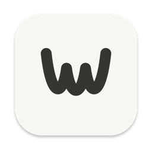
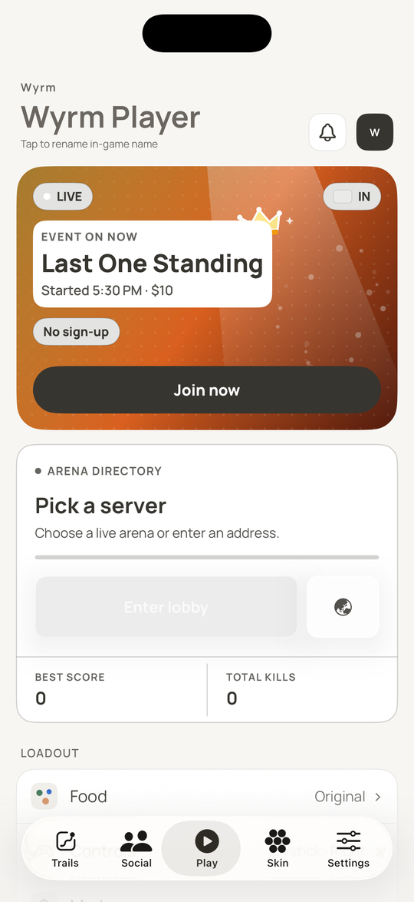
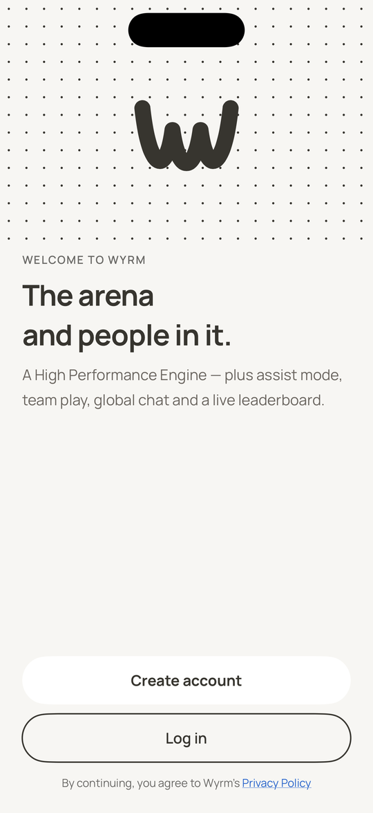
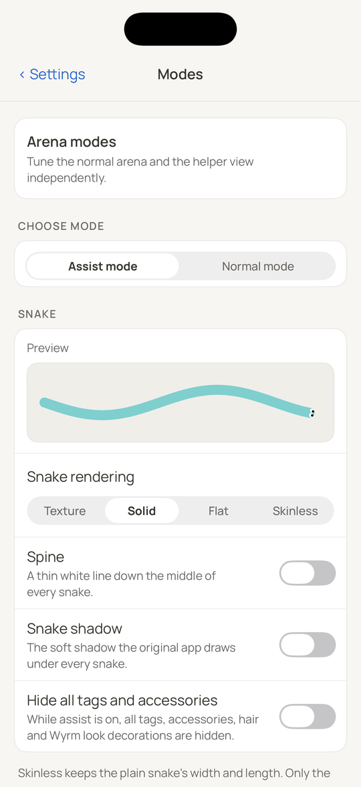
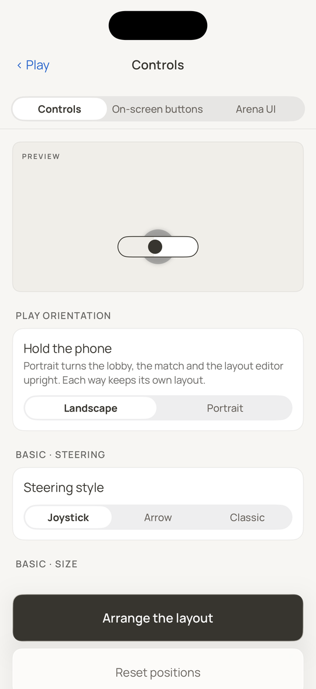

  

<h1 align="center">Wyrm for iPhone</h1>

  The slither game app I've been building, on your iPhone. 
  Needs iOS 15 or newer.

  <a href="https://github.com/disis-om/wyrm-ios/releases/latest"><b>⬇&nbsp; Download the latest version</b></a>

  &nbsp;
  

---

Hey! This is the iPhone version of Wyrm. Same account, same skins, same
friends as on Android, Windows and Mac. Log in and your settings follow you.

It plays on the real slither.io servers with a fast engine, so it stays smooth
even when the arena gets crowded. On top of that you get skins you build bead
by bead, team play, global chat, a live leaderboard, Trails, assist mode and a
lot of controls to make it feel the way you like.

  &nbsp;
  

## Installing

Wyrm isn't on the App Store, so you install the IPA yourself with a signing
app. Any of these work:

- **AltStore** or **SideStore** (free, with your Apple ID)
- **KSign** or **ESign** (if you already use one)

Steps:

1. Download `Wyrm-<version>-build-<n>.ipa` from the
   [latest release](https://github.com/disis-om/wyrm-ios/releases/latest).
2. Open it with your signing app and install it.
3. Open Wyrm, create an account or log in, and play.

There's also a step by step guide with pictures on
[wyrm.web.app](https://wyrm.web.app/download/iphone).

## Updates

Wyrm checks for new versions by itself. When there's one, you'll see a card in
the app, tap **Update now** and it hands the new IPA to your signing app.

You can also check yourself in **Settings › Updates**. Turn on
**Beta updates** there if you want new stuff a bit earlier than everyone else.

## Something not working?

Send me a message in Wyrm (Settings › Help & feedback) or on Discord and tell
me your iPhone model and iOS version. Crash reports are only sent if you say
yes.

For developers: how it's built

 

The app is a SwiftUI shell over the same C game engine as Android, drawn with
Vulkan on MoltenVK. Every build is compiled and tested on macOS by the GitHub
Actions workflow in `.github/workflows/`:

1. Fetch SDL3 and MoltenVK (SHA-256 pinned).
2. Prepare the engine snapshot (`Scripts/prepare-original-engine.py`).
3. Run the contract tests in `Tests/`.
4. Generate the Xcode project from `original-engine.yml`.
5. Build for iPhone and Simulator with code signing off, then run Simulator smoke tests.

| Path | What's in it |
| --- | --- |
| `SourcesShell/` | SwiftUI interface, account and service clients |
| `SourcesOriginal/` | UIKit container and the Swift/C bridge |
| `SharedEngine/` | Hash-checked snapshot of the Wyrm C engine |
| `Resources/` | App icon, fonts, art, privacy policy |
| `Scripts/`, `Tests/` | Engine preparation and checks |
| `update/` | The update manifests the app reads |

No signing certificates, keys, tokens or player data are stored here. Account
and team logins stay in the iOS Keychain.

---

The engine is GPL-3.0, see <code>SharedEngine/LICENSE</code>. © 2026 OM Rajput 
Slither.io names and artwork belong to their owners. Wyrm is independent and not affiliated with the game's developer.

